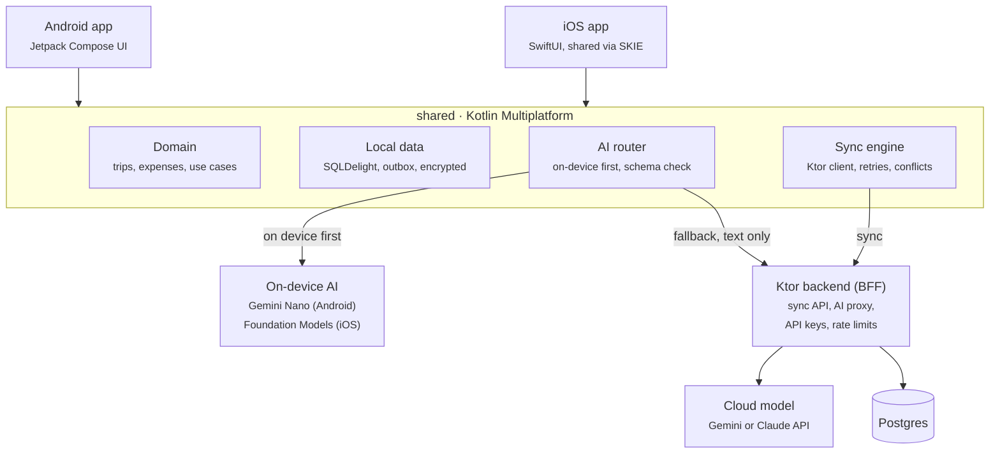
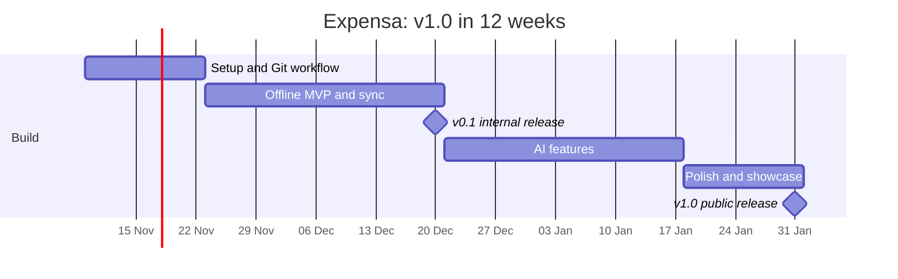

# Expensa: KMP Portfolio Project Plan

Owner: Firdous Shahani · Plan date: 2026-11-08 · Target: v1.0 public release on 2027-01-31

## Overview

Expensa is an offline-first travel and expense app for Android and iOS, built on Kotlin Multiplatform, that reads receipts and categorises spending with on-device AI. It is a 12-week side project (Nov 2026 to Jan 2027, about 6–8 hours a week) designed to be the one link on the CV that answers a German interviewer's three questions: can you own KMP end to end, can you ship AI features safely, and do you run a team-grade engineering process.

| Part of the project | What it shows an employer |
| --- | --- |
| Shared KMP core with Android and iOS apps | You can own a multiplatform codebase, including the iOS integration |
| Offline-first sync with conflict handling | Senior-level mobile system design, the topic of most interview rounds |
| On-device AI with cloud fallback | Practical AI delivery, privacy awareness and cost control |
| Git workflow, CI/CD and AI-assisted automation | You can set up and lead the engineering process for a team |
| README, architecture decision records, blog posts | You communicate decisions clearly, which German teams value |

Keep the scope small. One polished flow (capture a receipt, categorise it, sync it, see a trip total) beats many half-built screens.

## Features

Build the MVP first, then the AI features; stretch goals only if time is left.

| Priority | Feature | Notes |
| --- | --- | --- |
| MVP | Trips: create a trip with dates, currency and budget | Everything else hangs off a trip |
| MVP | Expenses: add, edit, delete; amount, currency, category, date, note | Works fully offline |
| MVP | Receipt capture with the camera, stored locally | CameraX on Android, a native camera view on iOS |
| MVP | Trip summary: total, per category, budget left | Converted to the trip currency |
| MVP | Sync to a backend with an outbox and conflict rules | The system-design centrepiece |
| AI | Receipt reading: merchant, total, date and category from a photo | On-device first, cloud fallback |
| AI | Smart categorisation of typed expenses | Structured output into a fixed category list |
| AI | Trip summary in plain language ("You spent 40% on food") | Summarisation, on device where supported |
| Stretch | Ask your expenses: "How much did I spend on taxis in Berlin?" | Cloud model with tool calls into local data |
| Stretch | Compose Multiplatform for one shared screen | Shows you can share UI too, not only logic |
| Stretch | Expose "add expense" to system assistants via Android AppFunctions | Experimental API; present it as an experiment |

## Architecture and tech stack

All business logic, sync and AI routing live once in the shared Kotlin Multiplatform module; the two apps are thin UI layers on top of it. The apps never talk to a model provider directly: on-device models run locally, and anything else goes through the backend, which holds the keys.



| Area | Choice |
| --- | --- |
| Shared code | Kotlin Multiplatform, coroutines and Flow, Koin, kotlinx.serialization |
| Networking | Ktor client |
| Local storage | SQLDelight with an outbox table for pending changes |
| Android UI | Jetpack Compose, Material 3, CameraX |
| iOS UI | SwiftUI; SKIE (or Swift export) for clean Swift APIs |
| Backend | Ktor server, Postgres, deployed with Docker |
| AI | ML Kit GenAI (Gemini Nano), Apple Foundation Models, cloud model via the backend |
| Build | Gradle version catalog, convention plugins |

## Repository structure

One public GitHub monorepo holds the apps, the shared code, the backend and the automation, so a reviewer sees the whole system in one place.

```
expensa/
├── shared/                 # KMP module: domain, data, sync, AI routing
│   ├── commonMain/         # business logic, Ktor client, SQLDelight, Koin
│   ├── androidMain/        # Gemini Nano / ML Kit GenAI bindings
│   └── iosMain/            # iOS platform bindings
├── androidApp/             # Jetpack Compose UI
├── iosApp/                 # SwiftUI app (Xcode project), consumes shared via SKIE
├── backend/                # Ktor BFF: sync API, AI proxy, auth
├── docs/
│   ├── PLAN.md             # this file
│   ├── adr/                # architecture decision records (0001-use-kmp.md, ...)
│   ├── ai-usage.md         # log of what AI tools got wrong and how it was caught
│   └── threat-model.md
├── .github/
│   ├── workflows/          # CI, release and AI-automation workflows
│   ├── ISSUE_TEMPLATE/
│   ├── pull_request_template.md
│   ├── CODEOWNERS
│   └── dependabot.yml
├── fastlane/               # Play Store and TestFlight lanes
├── gradle/libs.versions.toml
├── CLAUDE.md               # project rules for AI coding agents
└── README.md
```

`CLAUDE.md` (or an equivalent agents file) tells AI coding tools the architecture rules, test commands and conventions. It keeps AI-generated code consistent and is itself a talking point in interviews.

## Git workflow

Trunk-based development with short-lived branches and pull requests, even working alone. A tidy PR history is evidence of working the way a team does.

1. **Plan in issues.** Every piece of work starts as a GitHub issue using a template (feature, bug, chore), tracked on a GitHub Projects board.
2. **Branch from `main`.** Name branches by type and issue: `feat/12-receipt-capture`, `fix/31-sync-duplicate`, `chore/40-bump-kotlin`. Keep each branch under about 2 days of work.
3. **Commit with Conventional Commits.** `feat(sync): add outbox retry with backoff`, `fix(ios): crash on empty receipt`. Enforce the format with a commit-message check in CI.
4. **Open a PR with the template.** It asks for: what changed, why, screenshots or a short video, how it was tested, and whether AI tools wrote part of it.
5. **Pass the checks.** Lint, tests and both platform builds must be green, plus the AI review.
6. **Squash-merge into `main`.** One PR becomes one clean commit; the branch is deleted automatically.
7. **Release by tag.** Tagging `v0.3.0` triggers the release workflow. Versions follow semantic versioning and the changelog is generated from the commit messages.

Repository settings to turn on:

- Branch protection (a ruleset) on `main`: require a PR, require status checks to pass, require linear history, block force pushes.
- `CODEOWNERS` assigning yourself to every path, so the setup matches a real team.
- Dependabot for Gradle, GitHub Actions and Swift packages, grouped into one weekly PR.
- Secret scanning and push protection, so an API key can never reach the repo.

## CI/CD automation

Four GitHub Actions workflows cover every stage from pull request to store release. Keep each one small and readable, because reviewers will open them.

| Workflow file | Runs on | What it does |
| --- | --- | --- |
| `pr-checks.yml` | Every pull request | Commit-message check; ktlint and detekt; shared and Android unit tests; Kover coverage report posted as a PR comment; Android debug build; Roborazzi screenshot tests |
| `ios-build.yml` | Pull requests touching `shared/` or `iosApp/` | macOS runner: builds the shared framework and the iOS app, runs shared tests on the iOS simulator |
| `release.yml` | A `v*` tag | Builds a signed release AAB; Fastlane uploads it to the Play Console internal track; publishes a GitHub Release with generated notes; optional TestFlight upload |
| `backend.yml` | Changes in `backend/` | Tests the Ktor BFF and deploys it to a free-tier host (Cloud Run or Fly.io) |

- Use the Gradle setup action with build caching. Report build time in the README; it is a metric German platform teams care about.
- Keep signing keys and API keys in GitHub encrypted secrets, decoded only inside `release.yml`. Never commit a keystore.
- Run the expensive iOS job only when shared or iOS code changes, using path filters. macOS runners cost about 10 times the minutes of Linux ones on private repos; public repos run free.
- Add a nightly workflow that runs the full instrumented test suite on an emulator, so pull requests stay fast.
- Show status badges for build, coverage and latest release at the top of the README.

## AI-powered development automation

AI runs inside the workflow as a reviewer and assistant, and a human approves every merge. That balance, AI speed with human verification, is what employers now probe in interviews.

| Automation | Trigger | How to build it |
| --- | --- | --- |
| AI code review | Every pull request | An AI review action (for example Claude Code's GitHub Action, or GitHub Copilot code review) comments on the diff against the rules in `CLAUDE.md`: architecture boundaries, coroutine misuse, missing tests |
| Ask the agent in a PR or issue | Commenting `@claude` | The agent can explain code, propose a fix, or open a PR for a small issue. Review it like any other PR |
| Test-gap check | Every pull request | The review prompt also flags new public functions without tests, using the Kover report as input |
| Release notes | A `v*` tag | An AI step turns the Conventional Commit log into readable release notes for the GitHub Release and the Play Store "What's new" text |
| Issue triage | A new issue | An AI step adds labels (bug, feature, area) and asks for missing reproduction steps |
| Local agent work | While coding | Claude Code or Cursor for scaffolding and refactors, writing tests first, then reviewing every diff |

Guardrails (also documented in the README):

- AI suggestions are advisory. Required checks are lint, tests and builds; AI review never auto-merges.
- Workflows that call an AI API run with read-only repository permissions by default, and the API key lives in encrypted secrets.
- The PR template asks whether AI wrote part of the change, so the history shows how it was verified.
- `docs/ai-usage.md` logs what the AI got wrong (Gradle config, KMP expect/actual, threading). It turns into interview stories.

## In-app AI features

Every AI request goes through one shared `AiRouter` that tries on-device first and falls back to the cloud through the backend. The routing logic, with its privacy and cost rules, is the part interviewers will ask about.

How a receipt is read:

1. **Text extraction on device.** ML Kit Text Recognition on Android, Apple's Vision framework on iOS. Both run offline on almost every phone.
2. **Structured extraction.** The text goes to a small model that returns JSON: merchant, total, currency, date, category.
    - Android: Gemini Nano through the ML Kit GenAI Prompt API, on supported devices only. Check the feature status at runtime.
    - iOS: Apple's on-device Foundation Models framework, on Apple Intelligence devices.
    - Otherwise: a cloud model through the Ktor backend (Gemini via Firebase AI Logic, or the Claude API).
3. **Validation.** Shared code checks the JSON against the schema and the allowed category list. Bad output is rejected and the form opens for manual entry.
4. **User confirms.** AI pre-fills the form; the user always saves. The UI shows a small badge for on-device or cloud.

Rules the router enforces:

- **Privacy:** cloud calls send only the extracted text, never the photo, after redacting card numbers and emails. Users can switch cloud AI off in settings.
- **Keys:** the app never holds a model API key. The backend holds it and checks the app with Play Integrity or App Attest.
- **Cost:** the backend rate-limits each user and caches identical requests.
- **Safety:** receipt text is untrusted data. The prompt tells the model to extract fields only, and the schema check blocks anything else (prompt-injection defence).
- **Offline:** with no network and no on-device model, the expense is saved unprocessed and queued for later.

On-device model support is uneven across phones and some APIs were in preview as of mid-2026, so confirm availability before building on them.

## Testing, security and privacy

Strong tests in the shared core, where the logic lives, and a thin layer of UI and end-to-end tests on top.

| Layer | Tools | What to cover |
| --- | --- | --- |
| Shared unit tests | kotlin.test, Turbine, a fake Ktor engine | Sync engine (outbox, retries, conflicts), AI router decisions, JSON schema validation |
| Android UI | Compose UI tests, Roborazzi screenshots | Expense form, trip summary, light and dark themes |
| iOS | XCTest, shared tests on the simulator | Interop with the shared module |
| Backend | Ktor test host | Sync API, rate limiting, AI proxy error handling |
| Performance | Macrobenchmark, Baseline Profiles | Cold start and summary-screen scrolling |
| Stability | Firebase Crashlytics | Crash-free rate shown in the README |

Security and privacy checklist:

- Store data encrypted at rest (SQLCipher with SQLDelight, or platform encryption) and tokens in Android Keystore and iOS Keychain.
- Check the app against the OWASP MASVS list and record the result in `docs/threat-model.md`.
- Write a short privacy note covering what leaves the device, aligned with GDPR and Malaysia's PDPA.
- Support TalkBack, VoiceOver and dynamic text sizes; the European Accessibility Act makes this a real requirement for EU consumer apps.

## Week-by-week plan

v1.0 ships by 31 January 2027, so the repo is on the CV as January applications start; the AI work lands over the holidays.



Tick tasks off as you go. If a week slips, cut a stretch goal, never the tests or the README.

### Weeks 1–2: Setup and Git workflow (9–22 Nov)

- [ ] Create the public repo with the KMP template (shared, Android, iOS); run hello world on both platforms
- [ ] Add the version catalog, ktlint, detekt and `CLAUDE.md` with the architecture rules
- [ ] Turn on branch protection, CODEOWNERS, Dependabot, secret scanning; add issue and PR templates
- [ ] Write `pr-checks.yml` and `ios-build.yml`; get both green
- [ ] Install the AI code review action and test it on a small PR
- [ ] Write ADR 0001: why Kotlin Multiplatform

### Weeks 3–6: Offline MVP and sync (23 Nov – 20 Dec)

- [ ] SQLDelight schema for trips and expenses, with an outbox table
- [ ] Trip and expense screens in Compose; the same flow in SwiftUI
- [ ] Receipt capture with CameraX and on iOS, stored locally
- [ ] Ktor backend with the sync API, deployed by `backend.yml`
- [ ] Sync engine: outbox, retries with backoff, last-write-wins with a conflict log; full unit tests
- [ ] `release.yml` with Fastlane; tag v0.1.0 to the Play internal track

### Weeks 7–10: AI features (21 Dec – 17 Jan)

- [ ] On-device text recognition (ML Kit, Vision)
- [ ] AI router in shared code with the JSON schema check; unit-test each routing decision
- [ ] Gemini Nano via ML Kit GenAI on supported Android devices; Foundation Models on iOS
- [ ] Cloud fallback through the backend: redaction, rate limits, App Check or Play Integrity
- [ ] Smart categorisation and the plain-language trip summary
- [ ] AI release-notes step in `release.yml`; write blog post 1 on AI routing

### Weeks 11–12: Polish and showcase (18 – 31 Jan)

- [ ] Screenshot tests, Macrobenchmark and baseline profile; record the numbers
- [ ] Threat model, privacy note, accessibility pass
- [ ] README with demo GIF, badges and architecture diagram; remaining ADRs
- [ ] Tag v1.0.0; record the 2-minute demo video
- [ ] Add Expensa to the CV and LinkedIn Featured section

## Showcase

The repository is only useful if a recruiter understands it in 2 minutes, so the packaging matters as much as the code.

- **README:** a 60-second demo GIF at the top, then badges, the architecture diagram, the AI routing rules, how to run it, and measured results (cold start, build time, test count, crash-free rate).
- **Architecture decision records:** 5–8 short files, for example: why KMP over Flutter, SQLDelight over Room, outbox sync over direct writes, on-device first for AI, SKIE for Swift interop.
- **Blog posts (2–3):** "Routing between Gemini Nano and the cloud in a KMP app", "An offline-first sync engine in Kotlin Multiplatform", "What AI coding agents get wrong in KMP projects". Post on Medium or dev.to and share on LinkedIn.
- **Demo video:** 2 minutes on YouTube, linked from the CV and LinkedIn Featured section.
- **CV line:** add Expensa under a "Selected projects" heading with the repo link and one result.

Interview stories this project gives you:

1. How the sync engine resolves a conflict between two devices.
2. How the AI router decides between on-device and cloud, and what it never sends.
3. How prompt injection from receipt text is defended against.
4. How AI review and agents fit into the Git workflow, and a time the AI was wrong.
5. What would change to run this with a team of five.
